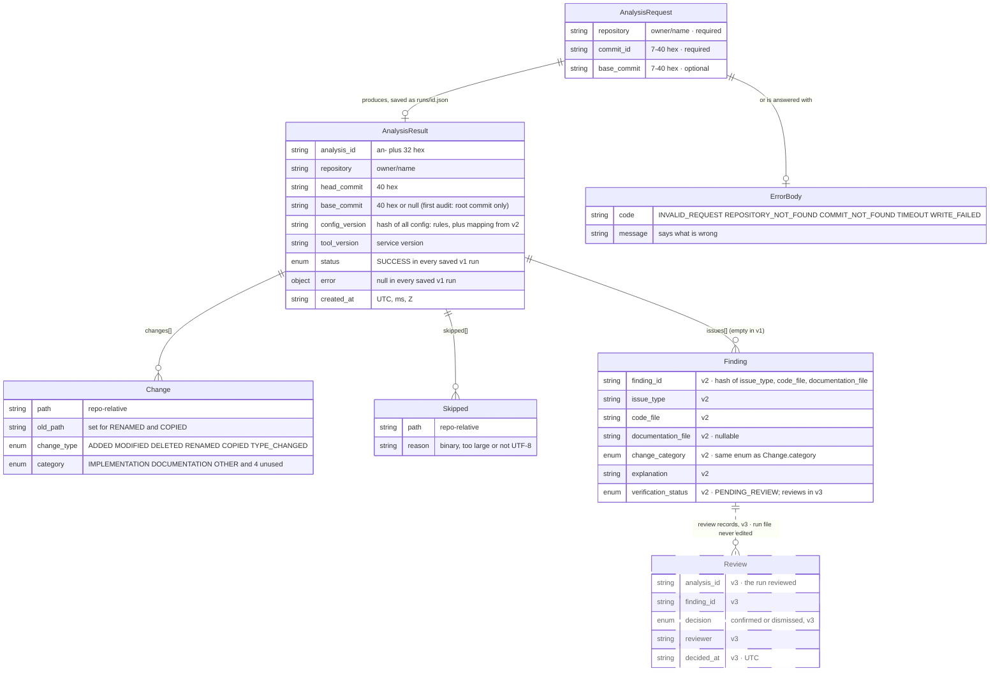

# M4 · Run file and API schema

**Question:** What does a request carry, and what is saved and returned for each run?

`Review` is shown for completeness but is not implemented in Phase 3. `Finding` is part of the v1 schema (slice 1), but `issues[]` is always empty until v2 (Phase 4), and review records come in v3 (Phase 5). The dashed line and box mark `Review`. Its shape still has to be agreed with the pod (roadmap decision 7).

`GET /system/analysis/{id}` always returns the run file's original bytes, so a reviewed finding still reads `PENDING_REVIEW` there; its current state lives in the `Review` records. `finding_id` is a hash of `issue_type`, `code_file` and `documentation_file`, so repeat runs give the same id (AC-10) and a review can carry over to later runs. Ask the pod what form theirs takes before v2, because the field is shared.

- **Representation.** Six records copied field for field from the pod's live OpenAPI, with one deliberate difference: DOCUMENTATION is added to the category enum, as Kaan decided. `Review` is a seventh record, ours until it is agreed with the pod.
- **Property.** One successful request produces one file, written once and never edited (REQ-04). All lists are sorted by path, so three runs on the same inputs differ only in `analysis_id` and `created_at` (REQ-07).
- **Checked by.** AC-06 (a separate JSON file with repo, commits, status and findings), AC-10 (repeat runs compare equal), and the conformance test, which expects differences only in `category` for doc files and in `config_version`.
