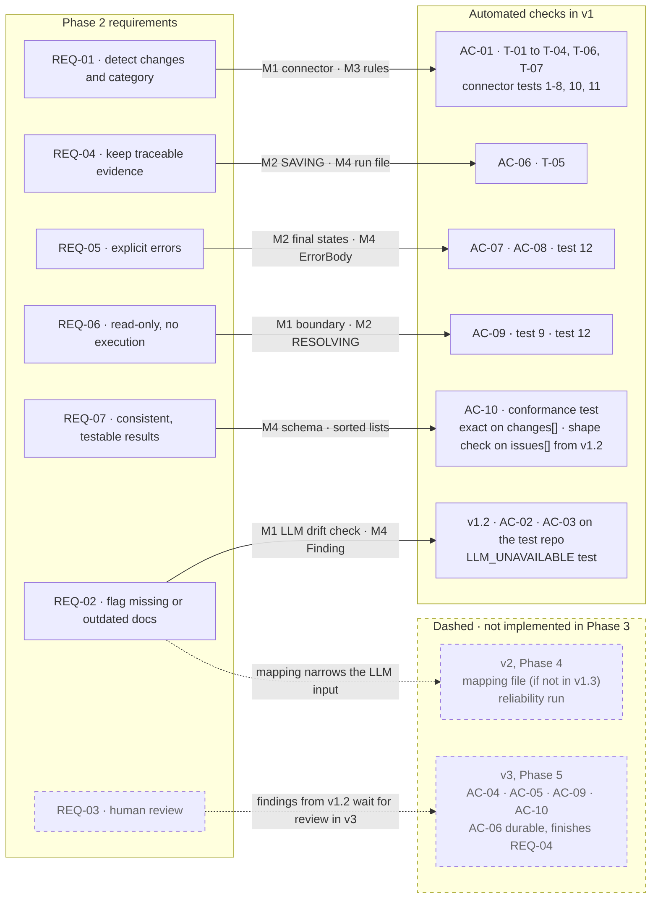

# M5 · Requirement traceability

**Question:** Which v1 model carries each Phase 2 requirement, and which automated check holds it?

**Dashed boxes and arrows are not implemented in Phase 3.** REQ-02 is carried from v1.2 by the LLM drift check and sharpened in v2 by the mapping; REQ-03 is closed in v3 (Phase 5). REQ-04 is held in v1 while the service stays up, and is fully closed in v3, when runs survive a redeploy and an idle spin-down.

- **Representation.** Each requirement points to the models that realize it, and each edge ends at the check that would fail if the realization broke.
- **Property.** All seven requirements are accounted for. Six are held by automated checks in v1 (REQ-02 from v1.2), and one is explicitly deferred, with the version and acceptance criteria that will close them. REQ-04 is held in v1 and finished in v3.
- **Checked by.** This model is itself the checklist for the v1 demo: every solid edge must have a passing check before v1 is called done. AC-10 is checked without its confidence clause, since the contract has no confidence field, and from v1.2 it matches `issues[]` by shape only, because the LLM is probabilistic until the final version.
