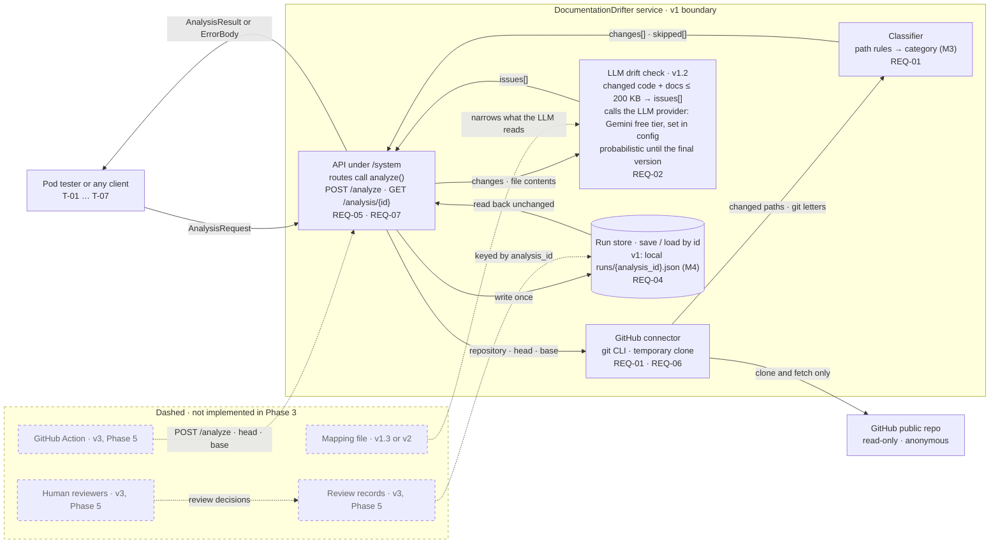

# M1 · v1 context and data flow

**Question:** What is inside v1, what is outside it, and what data crosses the boundary?

**Dashed boxes and arrows are not implemented in Phase 3.** They come in v1.3, v2 (Phase 4), v3 (Phase 5) or v4, and they are drawn only so the boundary of what Phase 3 delivers is explicit. The v0 webhook receiver was removed: the v3 GitHub Action covers the same events (roadmap decision 14).

- **Representation.** Five parts inside the boundary and one external system, plus the external LLM provider named inside the LLM drift check box. The drift check arrives in v1.2; v1.1 is the same picture without it. Each part names the requirement it carries. The routes only call `analyze()`, and the run store is reached only through `save` and `load` by `analysis_id`.
- **Property.** The only thing v1 does to the analysed repo is an anonymous clone and fetch into a temporary directory, so nothing in the repo is changed or executed (REQ-06). From v1.2, file contents leave the boundary only as the LLM prompt, and a failed LLM call fails the whole analysis rather than saving a run without findings. Every answer leaves through the API, and the run store is written once per successful analysis (REQ-04). Because the routes only wrap `analyze()`, a later caller reuses the same pipeline, and because storage sits behind `save` and `load`, v3 can make it durable by changing one module. Review decisions never edit a run file; they are separate records keyed by `analysis_id`.
- **Checked by.** AC-09 (the fixture repo hashes the same before and after), connector test 12 (a private repo is refused without credentials), and the conformance test against the pod's service.
