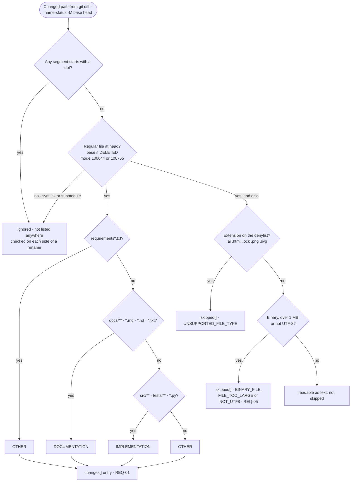

# M3 · File rules

**Question:** For each changed path, is it reported, skipped or ignored, and which category does it get?

Hidden paths, symlinks and submodules are ignored. Every other changed path is reported in `changes[]`, and a path that can't be read as text is also listed in `skipped[]` with a reason code (decision log, T12-Q1, T12-Q2 and T12-Q9).

Each entry in `changes[]` also carries a `change_type` taken from git's status letter:

| git letter | `change_type` | `old_path` |
|---|---|---|
| A | ADDED | null |
| M | MODIFIED | null |
| D | DELETED | null |
| R | RENAMED | the old path |
| C | COPIED | never produced: v1 runs `-M` only, so copies show as ADDED |
| T | TYPE_CHANGED | null |

A first audit (a root commit, so no base) diffs against the empty tree, so every path is ADDED.

**Hidden paths and renames.** The hidden-path check runs on each side of a rename. A rename out of a hidden path (`.github/a.md` → `docs/a.md`) is reported as ADDED with no `old_path`, and a rename into one (`docs/x.md` → `.archive/x.md`) as DELETED. A hidden path never appears anywhere, `old_path` included.

**Doc budget (v1.2).** The LLM is sent every DOCUMENTATION file at head, up to 200 KB in total (a config value). Docs past the budget go to `skipped[]` with the reason "over doc budget", so they are never reported as checked.

**Side.** The mode, size, binary and UTF-8 checks read the head side of each path, or the base side for DELETED. So a symlink that becomes a regular file is reported as TYPE_CHANGED, and a regular file that becomes a symlink is ignored; the conformance test checks this against the pod. The size and binary checks run only on changed paths, after `git diff --numstat` has fetched their blobs in one batch.

- **Representation.** Two admission checks, one ordered list of category rules where the first match wins, and a skip check: the extension denylist, then the binary, size and UTF-8 checks. The rules and the denylist live in one config file. `config_version` is a short hash of every config input that affects the output: the rules file in v1.1, plus the LLM provider, model and doc budget from v1.2, plus the mapping file at head once it lands in v1.3 or v2.
- **Property.** Every changed path is either ignored or in `changes[]`, and a path in `skipped[]` is always in `changes[]` too. Nothing that wasn't checked is reported as checked (REQ-05). The denylist and the content checks are the reference service's file-type rule plus our safety net; a file of a type the reference accepts that fails a content check is a known difference (T12-Q2). DESIGN, ARCHITECTURE, SPECIFICATION and REQUIREMENT have no rules in v1, so those files fall to DOCUMENTATION under `docs/` or when named `*.md`, `*.rst` or `*.txt`, and to OTHER otherwise.
- **Checked by.** T-04 (`docs/installation.rst` → DOCUMENTATION), connector tests 2, 3, 10 and 11 (added and deleted files, rename, hidden files, symlink and binary), and `tests/test_v1_skipped.py` (ticket 16), and T-03 (a rename is one change).
