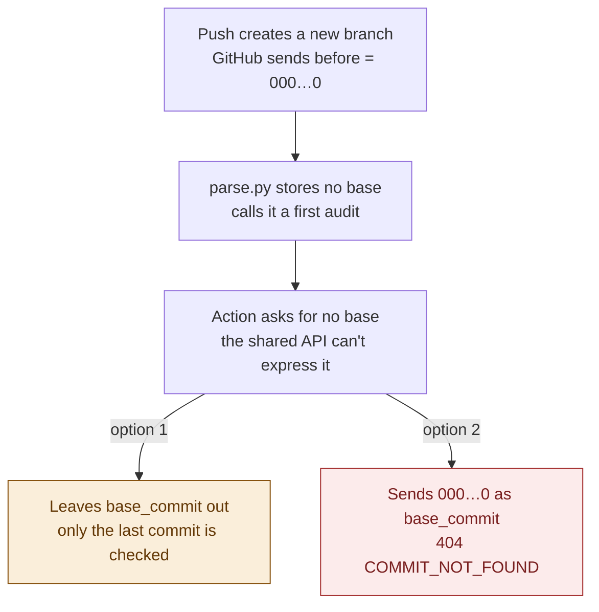
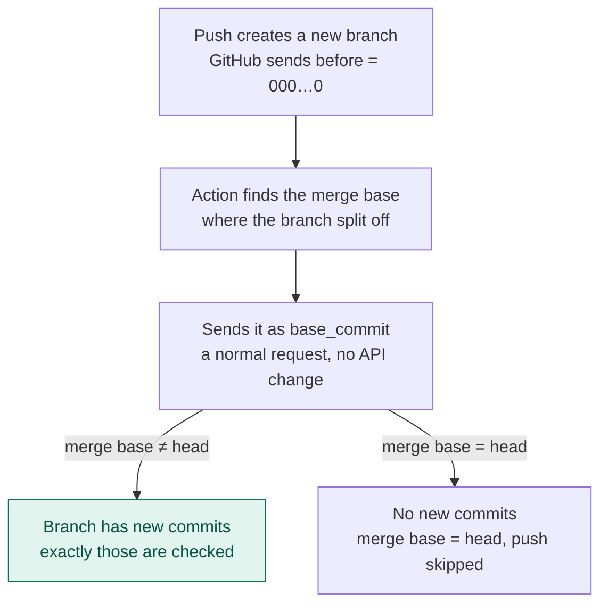

# Decision 15: the base for a push that creates a branch

**Question:** when a push creates a new branch, GitHub sends 40 zeros as `before`. What base commit should the analysis compare against?

**Decision (Kaan, 2026-10-17, roadmap decision 15):** the merge base with the default branch, which is where the branch split off. A first audit (no base, every file ADDED) happens only when the head is a root commit, the first commit of a repo.

This affects the v3 GitHub Action and the v4 webhook, which decide what base to send. The v1.1 service doesn't change either way. It already compares against the parent when `base_commit` is left out, does a first audit for a root commit, and answers a base of 40 zeros with 404 `COMMIT_NOT_FOUND`.

## Before: the schema's literal reading

[Schema v14](../Models/documentation-tracker-schema-v14.pdf) defines a first audit as an analysis with no base snapshot, and [phase2.pdf](phase2.pdf)'s M4 has the Action send "push before". Read together, a push that creates a branch would be a first audit. The v0 receiver (`Source/GitHub_Connector/parse.py`) was written that way.

Picture: [rendered/new-branch-schema-reading.png](rendered/new-branch-schema-reading.png).

Why it doesn't work:
1. **The shared API can't ask for "no base" when the head has a parent.** Leaving `base_commit` out means "compare with the parent", and 40 zeros isn't a commit. Only a root commit can be a first audit.
2. **Even if it could, it would check nothing useful.** A first audit lists the whole repo as ADDED, and schema v14 gives it "resolution checks only", meaning no findings. The branch's real changes would never be checked for drift.

## After: decision 15

Picture: [rendered/new-branch-decision-15.png](rendered/new-branch-decision-15.png). The PNGs are generated from the Mermaid blocks with `mmdc`; regenerate them after editing a block.

- The merge base comes from `merge_base_commit` in GitHub's compare endpoint, `GET /repos/{owner}/{repo}/compare/{default}...{head}`. The Action makes the same call for pull requests (decision 10) and force pushes, so this adds no new machinery. A sketch of the workflow is in [actions readiness](actions-readiness.md).
- The v3 Action runs on pushes to the default branch and on pull requests. A push that creates a branch therefore reaches it only once: the push that creates the default branch in a new repo. There the merge base equals the head, so it is skipped. Feature branches are checked through their pull requests.
- In v4, the webhook receives every push. This rule is what lets it check a new feature branch's own commits.

## Proposed, not decided: a first audit instead of a skip

When the default branch is first created and its head is a root commit, the Action could leave `base_commit` out instead of skipping. The service would then do a first audit, which is exactly the schema's behaviour, and the only case the shared API can express. If several commits were pushed at once, the service would compare the last one with its parent. Kaan to decide.

## What it changes from the schema

- **Unchanged:** a first audit still means an analysis with no base.
- **Clarified:** when one happens. A first audit happens only when the head is a root commit. A push that creates a branch compares against the merge base with the default branch.
- **Refined in phase2.pdf's M4:** "Action: PR base or push before" becomes the merge base for pull requests (decision 10), for force pushes, and for new branches (this decision). For a normal push, it stays the push's `before`.

## Where it is recorded

- [Roadmap](roadmap.md), decision 15 and v3 item 2
- [Connector guide](github-connector-steps.md), step 3's base table
- [CONTEXT.md](../CONTEXT.md), "First audit"
- [Models/v1](../Models/v1/README.md): M3 (a first audit is a root commit) and M4 (`base_commit` is null only for a root commit)
- Still open for the team: the comment and property name in v0's `parse.py`, which use the old reading (see [actions readiness](actions-readiness.md), "Edits applied", item 4)
